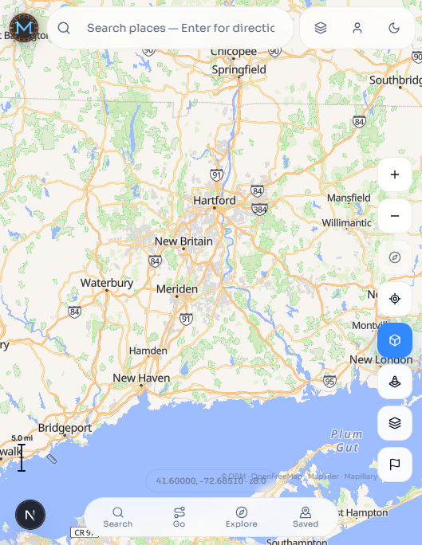
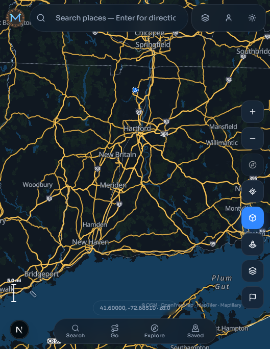

# Magnexis Maps

Cross-platform geographic intelligence, mapping, and navigation by **Magnexis LLC**.

Magnexis Maps is an open-development mapping platform built on MapLibre: interactive vector basemaps, PostGIS-backed places, search, community corrections with moderation, and provider-isolated routing/geocoding. It never invents routes, traffic, or place data.

> Beautiful maps. Intelligent navigation. Reliable geographic information.



**Version:** 1.4.0 (Chromatic) · Official mark: [`assets/branding/magnexis-maps-logo.png`](./assets/branding/magnexis-maps-logo.png)

**Website:** [magnexis-maps.netlify.app](https://magnexis-maps.netlify.app/) · [Privacy policy](https://magnexis-maps.netlify.app/privacy/) · [Support](https://magnexis-maps.netlify.app/support/) · [API health](https://magnexis-maps.netlify.app/api/v1/health)

The iPhone app packages this same web interface. [GitHub Actions build and signing instructions](docs/iphone-github-actions.md) describe hosted macOS validation and TestFlight upload.

## Demo

- **Product demo video:** [`docs/demo/magnexis-maps-demo.mp4`](./docs/demo/magnexis-maps-demo.mp4) — continuous live capture (MapLibre fly/ease, search, Standard → Night); regenerate with `docs/demo/record-demo.mjs`
- **Stills:** [`docs/demo/frames/`](./docs/demo/frames/)
- Local app: [http://localhost:3000](http://localhost:3000) after [Quick start](#quick-start)
- LinkedIn draft: [`docs/demo/linkedin-post-draft.md`](./docs/demo/linkedin-post-draft.md)

| Standard (light) | Magnexis Night |
| --- | --- |
|  |  |

## Features

- **Interactive MapLibre basemap** — OpenFreeMap liberty tiles with Magnexis **Chromatic** paints (Standard + Night)
- **Road hierarchy & shields** — real OSM `ref` / network shields; Noto-only OpenFreeMap fonts (no blank-map glyph 404s)
- **Place search** — PostGIS index plus optional TomTom / MapTiler geocoding when configured
- **Directions** — TomTom or Valhalla/OSRM when providers are set; no fabricated geometry
- **Magnexis VoiceNav** — browser TTS turn guidance when a real route exists
- **Community Intelligence** — issue reports, moderation, versioned apply/revert
- **Explore categories** — parks, transit, restaurants, fuel, EV, hospitals, and more
- **Optional layers** — live traffic (TomTom proxy), Mapillary street view, Google Places photos / Street View Static (server-side keys)
- **Admin dashboard** — moderation overview from live system state
- **iPhone distribution target** — Capacitor packages the same web interface with native foreground GPS, sharing, speech, connectivity, and app links; Xcode project prepared, device/signing/submission gates remain
- **Desktop (Tauri) & experimental mobile (Expo)** scaffolds

See [ROADMAP.md](./ROADMAP.md) for implemented vs planned status. Do not assume unlisted features exist.

## Stack

| Layer | Tech |
| --- | --- |
| Web | Next.js, MapLibre GL, Magnexis Horizon UI |
| API | Fastify, Zod, OpenAPI |
| Data | PostgreSQL + PostGIS, Redis |
| Monorepo | pnpm + Turborepo |
| Styles | `@magnexis/map-styles` (Chromatic engine, OFM fonts, RouteShield, GeoSymbols) |
| Deploy (web) | Netlify (`netlify.toml`) |
| CI | GitLab CI (`.gitlab-ci.yml`) |

## Monorepo layout

```
apps/web          Next.js + MapLibre UI
apps/admin        Moderation dashboard
apps/mobile       Expo Go client
apps/iphone       Shared web UI packaged for iPhone with Capacitor
apps/desktop      Tauri shell
services/api      Fastify REST API (:4000)
packages/*        shared, database, provider-adapters, map-styles, ui, navigation, …
infrastructure/   Docker Compose (PostGIS, Redis, optional Valhalla), migrations
docs/             Architecture, API, deployment, demo assets
assets/branding/  Official logo & icons
```

Details: [docs/architecture/ARCHITECTURE.md](./docs/architecture/ARCHITECTURE.md)

iPhone setup: [apps/iphone/README.md](./apps/iphone/README.md). App Store preparation and remaining blockers: [docs/iphone-app-store.md](./docs/iphone-app-store.md). Workflow comparison: [docs/google-maps-parity.md](./docs/google-maps-parity.md).

## Prerequisites

- **Node.js** 20+
- **pnpm** 9+ (`packageManager` pinned in root `package.json`)
- **Docker Desktop** — Postgres/PostGIS + Redis
- Optional: Rust (Tauri), Expo Go on device, Valhalla (`pnpm docker:routing`), TomTom / MapTiler / Mapillary / Google keys

Postgres is published on host port **5433** by default (avoids clashes with local 5432).

## Environment variables

Copy [`.env.example`](./.env.example) → `.env`. **Never commit `.env` or API keys.**

| Variable | Where | Purpose |
| --- | --- | --- |
| `DATABASE_URL` | API | PostGIS connection |
| `REDIS_URL` | API | Cache / sessions |
| `JWT_SECRET` | API | Auth sessions |
| `NEXT_PUBLIC_API_URL` | Web | API base URL |
| `NEXT_PUBLIC_MAP_STYLE_URL` | Web | Default style (OpenFreeMap liberty) |
| `MAP_STYLE_STANDARD` / `MAP_STYLE_DARK` | API | Style resolution for clients |
| `TOMTOM_API_KEY` | **API only** | Routing, search, traffic tile proxy — use `pnpm secrets:tomtom` |
| `ROUTING_PROVIDER` / `GEOCODING_PROVIDER` | API | `tomtom`, `valhalla`, `osrm`, `maptiler`, … |
| `VALHALLA_URL` | API | Local Valhalla after `pnpm docker:routing` |
| `MAPTILER_KEY` / `NEXT_PUBLIC_MAPTILER_KEY` | API / Web | Terrain & satellite styles |
| `NEXT_PUBLIC_MAPILLARY_ACCESS_TOKEN` | Web | Optional street-view coverage |
| `GOOGLE_MAPS_API_KEY` | **API only** | Optional Places photos / Street View Static proxy — `pnpm secrets:google` |
| `GOOGLE_OAUTH_CLIENT_ID` / `NEXT_PUBLIC_GOOGLE_OAUTH_CLIENT_ID` | API / Web | Sign in with Google (ID token verification) |

Missing routing/geocoding credentials return clear `503 PROVIDER_UNAVAILABLE` responses — the API will not invent results.

### GitHub Packages (API client)

Install the typed API client from this repository’s packages:

```bash
# .npmrc
@magnexis:registry=https://npm.pkg.github.com
//npm.pkg.github.com/:_authToken=YOUR_GITHUB_TOKEN

npm install @magnexis/api-client@1.0.0
```

Publish is driven by `.github/workflows/publish-packages.yml` on `api-v*` tags (or manual dispatch). Desktop 1.0 releases use `desktop-v*` tags.

**Security:** keep commercial keys server-side. Prefer `TOMTOM_API_KEY` + traffic proxy over `NEXT_PUBLIC_TOMTOM_KEY`. Do not put production Google keys in `NEXT_PUBLIC_*`.

## Quick start

```bash
pnpm install
cp .env.example .env
pnpm docker:up
pnpm --filter @magnexis/shared --filter @magnexis/database --filter @magnexis/provider-adapters --filter @magnexis/api-client build
pnpm db:migrate
pnpm db:seed

# terminal A — API
pnpm --filter @magnexis/api dev

# terminal B — web
pnpm --filter @magnexis/web dev
```

| Service | URL |
| --- | --- |
| Web | http://localhost:3000 |
| API | http://localhost:4000 |
| OpenAPI | http://localhost:4000/docs |
| Admin | `pnpm --filter @magnexis/admin dev` → http://localhost:3001 |

Dev admin after seed: `admin@magnexis.local` / `MagnexisAdmin1!` (local only — change in any shared environment).

### Optional TomTom

```bash
pnpm secrets:tomtom   # interactive; writes TOMTOM_API_KEY to .env
# Prefer: ROUTING_PROVIDER=tomtom  GEOCODING_PROVIDER=tomtom
```

### Optional local Valhalla (CT extract)

```bash
pnpm docker:routing
# ROUTING_PROVIDER=valhalla
# VALHALLA_URL=http://localhost:8002
```

## Architecture overview

```
Browser / Tauri / Expo
        │
        ▼
   Fastify API (:4000)
        │
   ┌────┼────────────┐
   ▼    ▼            ▼
PostGIS Redis   Providers
                (OpenFreeMap tiles, TomTom,
                 Valhalla/OSRM, Mapillary, Google)
```

1. Geographic data lives in PostGIS with provenance.
2. Provider adapters isolate tiles, routing, and geocoding.
3. UI never invents route geometry or live traffic.
4. Community corrections require moderation before place mutation.
5. Chromatic paints restyle OpenFreeMap liberty for Standard and Night without switching to OFM dark (which omits shields/POIs).

## Map styles & Chromatic

- **Basemap:** OpenFreeMap [liberty](https://tiles.openfreemap.org/styles/liberty) (OpenMapTiles) — roads, labels, shields, POIs; no tile API key.
- **Fonts:** OpenFreeMap glyph stacks use **Noto Sans only**. Composite Open Sans stacks 404 on OFM and previously caused MapLibre to hold whole tiles blank; fixed in `@magnexis/map-styles`.
- **Chromatic:** `applyChromaticPaints` — Standard (cool pastel land, slate highways) and Night (dark land, gold highways).
- **Terrain / satellite:** MapTiler outdoor-v4 / satellite-v4 when a MapTiler key is set; labels shared via the liberty pipeline.

## Providers

| Provider | Role | Notes |
| --- | --- | --- |
| **OpenFreeMap** | Vector basemap + fonts/sprites | Default; free OSM-derived tiles |
| **OpenStreetMap** | Source data attribution | Required in production attribution |
| **TomTom** | Routing, search, traffic tiles | Server-side key; optional |
| **Valhalla / OSRM** | Self-hosted / demo routing | Valhalla via Docker profile |
| **MapTiler** | Terrain, satellite, optional geocode | Key required |
| **Mapillary** | Street-level imagery | Optional client token |
| **Google Maps Platform** | Places photos, Street View Static | Optional; API proxy only |

Attribution and license matrix: [DATA_SOURCES.md](./DATA_SOURCES.md)

## Deploy

- **Netlify (web):** [`netlify.toml`](./netlify.toml) builds `@magnexis/web`. Set `NEXT_PUBLIC_API_URL` in the Netlify UI.
- **GitLab CI:** [`.gitlab-ci.yml`](./.gitlab-ci.yml) — install, test, typecheck, build.
- **API:** deploy Fastify separately; point the frontend at it.

More: [docs/deployment/DEPLOYMENT.md](./docs/deployment/DEPLOYMENT.md)

## Tests

```bash
pnpm --filter @magnexis/shared test
pnpm --filter @magnexis/api test
pnpm --filter @magnexis/map-styles test
```

## Contributing

1. Fork or branch from `main`.
2. Keep changes focused; prefer conventional commits (`feat`, `fix`, `chore`, `docs`, `refactor`, `test`).
3. Do not commit secrets, `.env`, or provider keys.
4. Run typecheck/tests for touched packages before opening a merge request.
5. Update [ROADMAP.md](./ROADMAP.md) / [CHANGELOG.md](./CHANGELOG.md) when behavior changes.

Issues and MRs on the GitLab project are welcome for bugs, docs, and scoped features aligned with the roadmap.

## Security

- Report sensitive issues privately to Magnexis LLC rather than opening a public issue with secrets.
- Rotate any key that appears in chat, screenshots, or git history.
- Local seed credentials are for development only.

## License

Proprietary — Magnexis LLC. See [LICENSE](./LICENSE). Third-party datasets and fonts retain their own licenses ([DATA_SOURCES.md](./DATA_SOURCES.md)).
